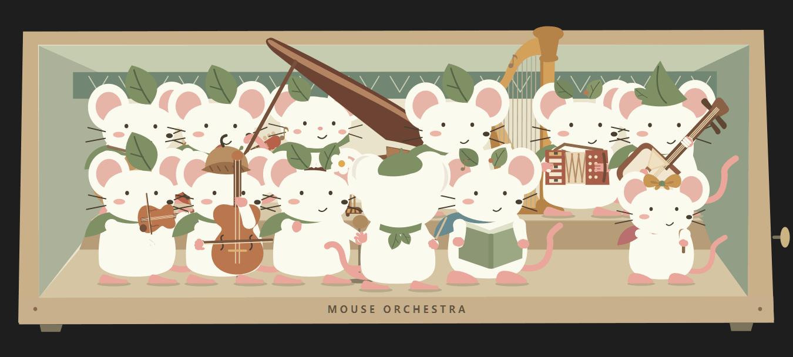
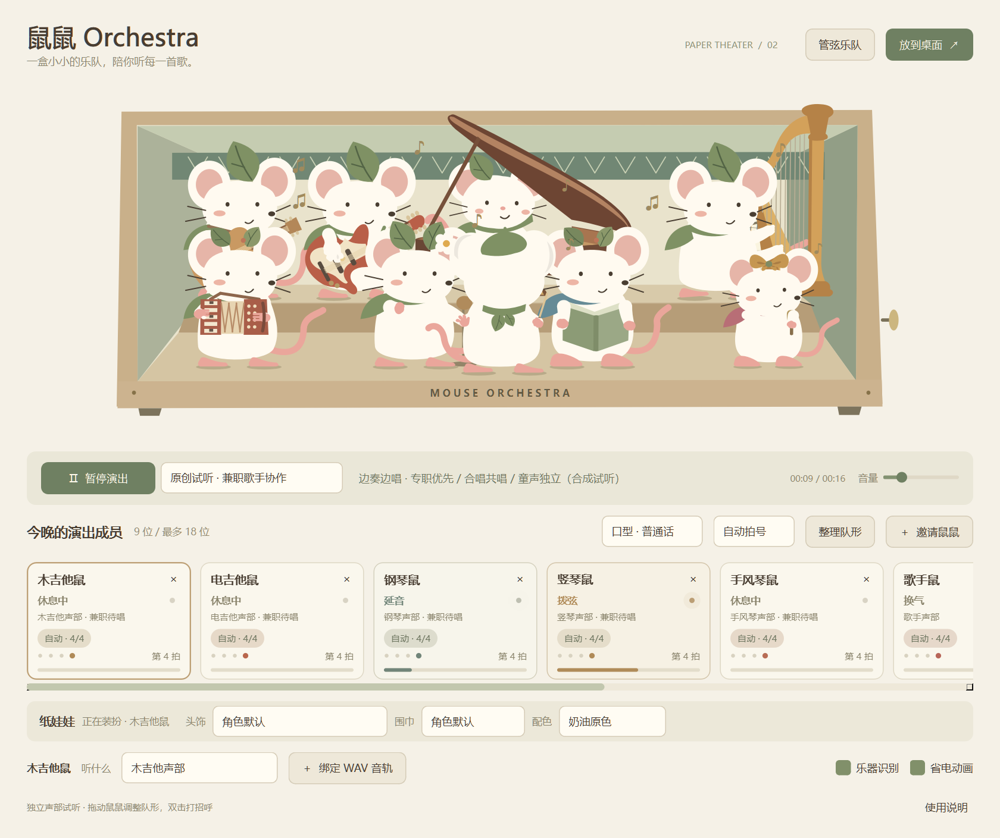

<div align="center">

# 鼠鼠 Orchestra

### 一盒小小的乐队，陪你听每一首歌。

无描边的森林鼠鼠 · 可自由编队的桌面音乐盒 · 本地音频驱动

[下载 Windows 预览版](https://github.com/Guzi2005/mouse-orchestra-releases/releases/tag/v0.2.38) · [快速上手](#三分钟开始演出) · [反馈问题](https://github.com/Guzi2005/mouse-orchestra-releases/issues/new?template=bug_report.yml)


</div>

指挥会给拍，鼓手会甩腕，提琴手会换弓，竖琴手会拨弦。你可以把喜欢的成员放进发条盒子，替它们换装、拖动站位，或让旋律乐手边弹边唱。

**当前版本：v0.2.38 · 公开预览版 · Windows x64。** 无需安装 Python，也无需登录或联网运行。公开仓库用于下载、说明和问题反馈；应用开发源码暂未公开。

## 看看它们怎么演奏

下方 GIF 是应用实际绘制的动作，使用原创合成声部／已知演奏事件驱动，**不代表对真人歌曲的识别准确率**。GIF 没有声音，下载后的专用试听入口可以同步听见对应声音。

<details open>
<summary><b>竖琴：单拨、琶音与上下扫弦</b></summary>


</details>

<details>
<summary><b>沙锤：双手同起同落，头身随重音律动</b></summary>


</details>

<details>
<summary><b>边奏边唱：按场上人数分配主唱与和声</b></summary>



</details>

## 下载与运行

1. 打开 [v0.2.38 下载页](https://github.com/Guzi2005/mouse-orchestra-releases/releases/tag/v0.2.38)，在 **Assets** 中下载 **MouseOrchestra-v0.2.38-Windows-x64.zip**。
2. **完整解压**，进入解压后的 `MouseOrchestra` 文件夹。
3. 双击 `MouseOrchestra.exe`，或 `启动鼠鼠.cmd`。

请保留同目录的 `_internal` 文件夹；把 exe 单独移走会缺少运行库。GitHub 自动生成的 **Source code (zip/tar.gz)** 只有此公开仓库的文档和图片，**不是应用下载包**。

需要 Windows 10/11 的 64 位系统和可用的音频输出设备。本版没有安装程序、签名证书或自动更新器；Windows 可能提示发布者未知。请核对下载来源，遇到拦截可先提交反馈，无需关闭系统防护。

发布页提供 `SHA256SUMS.txt`，可在 PowerShell 核对文件：

```powershell
Get-FileHash .\MouseOrchestra-v0.2.38-Windows-x64.zip -Algorithm SHA256
```

## 三分钟开始演出

**先听原创试听。** 初次打开排练室，点击“开始演出”。试听只混合场上启用成员对应的声部；邀请或移除乐手，会改变听到的编制。

**再听自己的音乐。** 切换来源为“聆听系统声音”，开始聆听，然后用平常的播放器播放音乐。应用读取 Windows 默认播放设备的输出，不需要麦克风。系统声音里的复杂合奏采用轻量类别判断和音响特征；若已经有分好的声部，可选“我的独立音轨”绑定 WAV，动作会更直接。

**最后放到桌面。** 点击右上角“放到桌面”，音乐盒会变成透明、置顶的桌宠。拖盒边移动整个盒子，右键切换小／中／大；双击盒边或托盘图标返回排练室。



## 组建自己的鼠鼠乐团

- **23 种角色可选，最多 18 位同时在场。** 指挥、歌手、和声、小小、大小提琴、木吉他、电吉他、三味线、钢琴、手风琴、竖琴、双簧管、单簧管、竹笛、圆号、小号、长号、大号、小鼓、架子鼓、三角铁、沙锤；可以有多位同职业成员。
- **一键管弦编队。** “管弦乐队”安排 16 位成员，支持撤销换队；“整理队形”将指挥放在中央最前。人数增加时使用前后两层台阶，也可以自己拖动站位。
- **纸娃娃换装。** 点击成员或卡片，更换头饰、围巾和五种配色。队形、装扮和兼职歌手偏好会自动保存。
- **乐手也能唱。** 右键木／电吉他、钢琴、竖琴、手风琴、三味线、大小提琴或其卡片，进入“兼职歌手”：只演奏、自动分工、优先主唱、只唱和声。唱歌可以另绑独立 WAV，不会替换乐器声部。
- **可见的音乐反应。** 成员卡片显示实际动作、声部、强度和拍号；拍号不确定时标为示意。眼神连续移动，成员入场时互望、看指挥；休止后会收势和待机。
- **声乐并行。** 主唱、和声与童声可以同时开口；自动分工优先专职主唱，其他成人可唱成员参与已检测到的合唱。小小鼠需要童声特征证据，不会因高音自动接管主唱。

## 试听入口

解压包内有几个不覆盖已保存队形的专用试听：

- `试听兼职歌手.cmd`：边奏边唱、主唱／和声／童声分工。
- `试听竖琴.cmd`：单拨、琶音、上下扫弦和双手和弦。
- `试听沙锤.cmd`：同步双手、轻摇、重音、连击与收势。
- `试听架子鼓.cmd`：各鼓件、双击、连招和踏板配合。
- `试听管弦乐队.cmd`：一键管弦编队的合成试听。

关闭试听窗口后，再通过正常入口打开，就会恢复原来保存的队形。

## 关于识别：有什么依据，哪里还不够

这是一个节约资源的音乐桌宠，采用本地 CPU 上的共享音频分类模型及频谱、起音、能量、音高和节拍特征，**没有逐乐器源分离，也没有逐人声分轨**。

独立声部绑定最直接；原创试听使用已知演奏事件。系统混音的乐器身份和动作采用近似映射，复杂合奏可能漏奏、误动或共享同一个起音。双簧管、竹笛、三味线、低鼓与其他低音的区分仍有边界；自动拍号也可能混淆。

主唱、和声、小小的类别可以并存，但自然混音里的多位歌手不能被逐人精确分配。只有一位成人可唱成员时会合并成人声乐能量、采用中性口型；中文／日语／通用元音选项是声学口型近似，不是歌词识别或精确唇读。“童声”表示音色特征，不证明演唱者年龄。

**本版验证：** 106 项回归通过，包含实际播放和 Windows 回环采集；兼职声乐流程检查了 384 个原生帧与 8 个已知录音／受控混合场景。它们是功能与回归证据，不是通用识别准确率。

## 常见问题

<details>
<summary><b>已经播放音乐，鼠鼠还没动？</b></summary>

确认来源为“聆听系统声音”、已经开始聆听，并且播放器使用 Windows 默认输出设备。非静音弱音可能需要积累约一秒类别上下文；复杂混音仍会漏检。也可先用原创试听确认动作正常，或者绑定对应的独立 WAV。

</details>

<details>
<summary><b>关掉“乐器识别”，歌手还会唱吗？</b></summary>

会。场上有启用的专职或兼职声乐成员时，人声监听独立工作，仍共用同一个模型。所有可唱成员关闭且乐器识别也关闭后，模型会释放。原创试听与独立声部不需要这个模型。

</details>

<details>
<summary><b>支持哪些文件？音轨绑定会保存吗？</b></summary>

独立声部接受 PCM WAV：8／16／24／32 位、单／多声道，自动重采样。暂不直接导入 MP3 或浮点 WAV；单条最长 10 分钟，解码缓存合计不超过 96 MB。多条 WAV 从各自文件开头同步播放，请自行准备对齐文件。音轨绑定需要每次启动后重新选择，程序不会把你的 WAV 复制进应用包。

</details>

<details>
<summary><b>如何更新、退出或卸载？</b></summary>

退出旧版本，将新版本解压到新目录再运行。桌面模式从鼠鼠右键菜单或托盘退出；关闭排练室也会退出。无需安装，删除解压目录即可移除程序。编队配置另存在本机应用数据目录中的 `MouseOrchestra/ensemble.json`；删除程序目录不会同时删除这份配置。

</details>

## 本地运行与许可

模型随包提供，程序没有账户、云端推理或遥测上传流程。系统监听的数据在内存中分析，默认不录音、不保存歌曲。程序不自动连接 GitHub；更新与反馈由你手动进行。

本次是**公开可下载的预览发行**，应用源码暂未公开，因此没有把整个项目套用 MIT／GPL 开源许可证。项目原创内容与第三方组件分别适用其许可；请阅读 [使用与许可说明](USAGE.md) 和 [第三方署名](THIRD_PARTY_NOTICES.md)。

其中 IRMAS 派生的可选音色权重采用 **CC BY-NC-SA 3.0，仅限非商业使用**。Qt／PySide6 使用 LGPL 动态运行库；发布页同时提供对应第三方源码和替换运行库说明，第三方源码不包含本项目私有开发源码。

## 反馈与后续

欢迎在 [Issues](https://github.com/Guzi2005/mouse-orchestra-releases/issues) 提交问题、动作建议和识别误例。最好附版本、Windows 版本、声源模式、在场成员、出错时间点和期望动作。**请勿上传没有分享授权的完整歌曲、账号信息或个人文件。** 可给公开歌曲链接及具体时间段。

后续优先改善真人合奏的漏检／误动、可回放的诊断，以及新作品验证；不会把失败候选或合成试听当成精确分轨已经实现。

<div align="center">

Mouse Orchestra — a small paper theater for your desktop. Windows x64 portable preview, local audio analysis, customizable musicians. Application source is not yet public.

</div>
