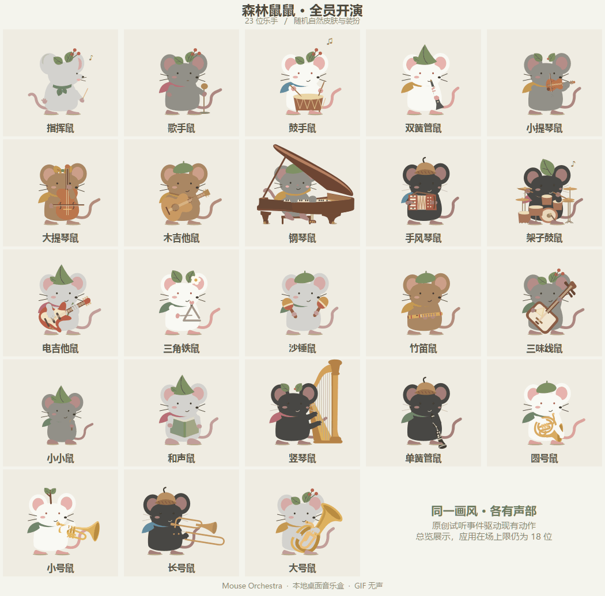
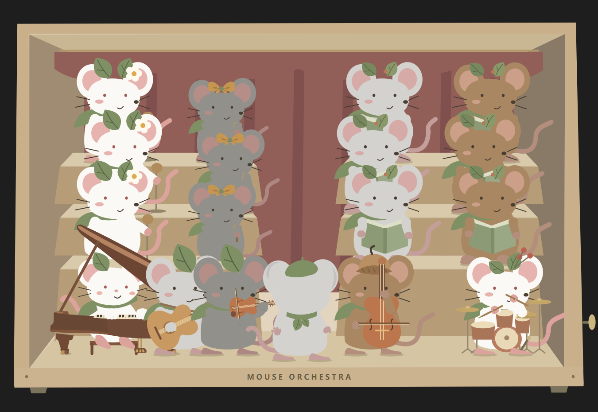
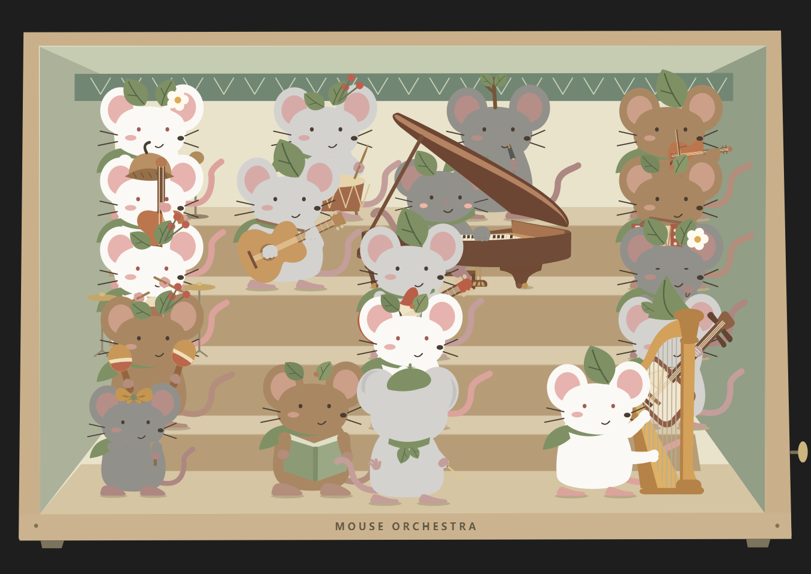
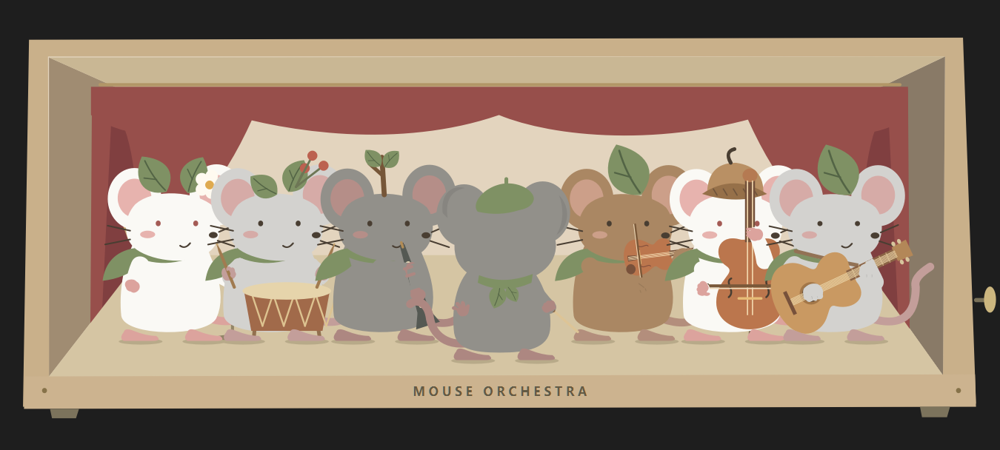

<div align="center">

# 鼠鼠 Orchestra

### 一盒小小的乐队，陪你听每一首歌。

无描边的森林鼠鼠 · 可自由编队的桌面音乐盒 · 本地音频驱动

[下载 Windows 预览版](https://github.com/Guzi2005/mouse-orchestra-releases/releases/tag/v0.2.42) · [快速上手](#三分钟开始演出) · [反馈问题](https://github.com/Guzi2005/mouse-orchestra-releases/issues/new?template=bug_report.yml)


</div>

指挥会给拍，鼓手会甩腕，提琴手会换弓，竖琴手会拨弦。你可以把喜欢的成员放进发条盒子，替它们换装、拖动站位，或让旋律乐手边弹边唱。

**当前版本：v0.2.42 · Windows x64 预览版。** 解压即用，无需登录。此仓库提供下载和问题反馈，应用源码暂未公开。

**默认使用完整配置：人声与乐器识别同时启用，省电动画关闭，演奏约 30fps**

## 看看它们怎么演奏

23 位鼠鼠的演奏总览，随机搭配皮肤、头饰和围巾。动画来自应用内的原创试听；GIF 无声，下载后可以听完整试听。



<details open>
<summary><b>竖琴：单拨、琶音与上下扫弦</b></summary>


</details>

<details>
<summary><b>沙锤：双手同起同落，头身随重音律动</b></summary>


</details>

<details>
<summary><b>边奏边唱：按场上人数分配主唱与和声</b></summary>


</details>

## 下载与运行

1. 打开 [v0.2.42 下载页](https://github.com/Guzi2005/mouse-orchestra-releases/releases/tag/v0.2.42)，在 **Assets** 中下载 **MouseOrchestra-v0.2.42-Windows-x64.zip**。
2. **完整解压**，进入解压后的 `MouseOrchestra` 文件夹。
3. 双击 `MouseOrchestra.exe`，或 `启动鼠鼠.cmd`。

请保留同目录的 `_internal` 文件夹；把 exe 单独移走会缺少运行库。GitHub 自动生成的 **Source code (zip/tar.gz)** 只有此公开仓库的文档和图片，**不是应用下载包**。

支持 Windows 10/11 64 位。当前版本未签名，Windows 可能提示发布者未知；请从本仓库的 Release 下载。

发布页提供 `SHA256SUMS.txt`，可在 PowerShell 核对文件：

```powershell
Get-FileHash .\MouseOrchestra-v0.2.42-Windows-x64.zip -Algorithm SHA256
```

## 三分钟开始演出

**原创试听：** 在排练室点击“开始演出”。音乐只播放场上成员对应的声部，邀请或移除乐手即可改变编制。

**跟随自己的音乐：** 选择“聆听系统声音”，开始聆听，再用播放器播放音乐。应用监听 Windows 默认输出设备，不需要麦克风。已有分轨 WAV 的话，也可以在“我的独立音轨”中绑定声部。

**放到桌面：** 点击右上角“放到桌面”。拖盒边移动音乐盒，右键切换小／中／大；双击盒边或托盘图标返回排练室。


## 组建自己的鼠鼠乐团

- **23 种角色可选，最多 18 位同时在场。** 指挥、歌手、和声、小小、大小提琴、木吉他、电吉他、三味线、钢琴、手风琴、竖琴、双簧管、单簧管、竹笛、圆号、小号、长号、大号、小鼓、架子鼓、三角铁、沙锤；可以有多位同职业成员。
- **一键管弦编队。** “管弦乐队”安排 16 位成员；“整理队形”将指挥放在中央最前，也可以手动拖动站位。
- **纸娃娃换装。** 点击成员或卡片，更换头饰、围巾和皮肤。队形、装扮和兼职歌手设置自动保存。
- **乐手也能唱。** 右键木／电吉他、钢琴、竖琴、手风琴、三味线、大小提琴或其卡片，进入“兼职歌手”：只演奏、自动分工、优先主唱、只唱和声。唱歌可以另绑独立 WAV，不会替换乐器声部。
- **演奏反馈。** 卡片显示声部、强度和拍号，演奏时有动效。鼠鼠会交换眼神、看指挥，休止时收势。
- **主唱、和声与童声。** 三类成员可以同时演唱，按识别结果和场上阵容分工。

## 自然皮肤


五款皮肤：实验室小鼠白、缎子鼠浅灰、家鼠灰、家鼠黑、田鼠棕。在纸娃娃或右键“装扮这只鼠鼠 → 皮肤”中更换。

## 为乐团换一个剧场

从 **“剧场样式 ▾”** 选择一至五层纸盒，或三款经典舞台。默认使用双层纸盒。

**经典合唱台**：后景幕布、左右各三层阶台和中央通道；歌手／和声／小小上阶台，乐器与指挥在底层，指挥在中央最前。**镜框剧院**是侧边束起红幕的单层前台；**室内音乐厅**以木质音墙搭配双层乐队。



<details>
<summary><b>五层纸盒和红幕剧院</b></summary>





</details>

各款剧场分别保存站位，切换后可恢复排布。鼠鼠可以在台阶间拖动；“整理队形”会重新编队。高箱体在排练室中可滚动查看。

## 曲目与阵容预设

右上角 **“试听预设 ▾”** 会同时载入曲目与合适的编制。除了原有《叶间小步舞》，还有三首原创合成试听：

- **把灯留给你**：84 BPM 的抒情合唱，主唱、和声、童声应答，钢琴与清音电吉他、弦乐和鼓组。
- **莓果跳跳**：112 BPM 的拨扫律动，木／电吉他、反拍鼓组、双手同步沙锤及主唱和声。
- **月光落叶**：90 BPM 的三拍小乐队，竖琴单拨／琶音／扫弦，弦乐长句、竹笛与三角铁。

**“Heal the World · 官方音源联动”** 配置 11 位成员，包括电吉他、架子鼓、小小鼠、主唱、两位和声、钢琴、弦乐和指挥。选择后打开 [Michael Jackson 官方播放页](https://www.michaeljackson.com/watch/heal-the-world/) 并开始系统监听；在页面播放原曲即可。原曲不包含在应用包内。

阵容参考 [发行署名](https://music.apple.com/us/song/655263571)，电吉他为扩展编制。原创试听可离线播放。选择 **“撤销试听换队”**，恢复之前的成员、站位、配饰和声源。

## 试听入口

解压包内有几个不覆盖已保存队形的专用试听：

- `试听兼职歌手.cmd`：边奏边唱、主唱／和声／童声分工。
- `试听竖琴.cmd`：单拨、琶音、上下扫弦和双手和弦。
- `试听沙锤.cmd`：同步双手、轻摇、重音、连击与收势。
- `试听架子鼓.cmd`：各鼓件、双击、连招和踏板配合。
- `试听管弦乐队.cmd`：一键管弦编队的合成试听。

关闭试听窗口后，再通过正常入口打开，就会恢复原来保存的队形。

## 音频识别

音频在本机 CPU 上分析。系统监听根据音色、起音、音高和节拍驱动动作，复杂合奏仍可能漏奏或误动；目前不支持自动分离每件乐器、每位歌手的音轨。想让动作直接对应声部，可以绑定独立 WAV。

口型支持中文、日语和通用元音，是声音特征的近似表现，不识别歌词。童声按音色判断。

## 常见问题

<details>
<summary><b>已经播放音乐，鼠鼠还没动？</b></summary>

确认来源为“聆听系统声音”、已经开始聆听，并且播放器使用 Windows 默认输出设备。非静音弱音可能需要积累约一秒类别上下文；复杂混音仍会漏检。也可先用原创试听确认动作正常，或者绑定对应的独立 WAV。

</details>

<details>
<summary><b>关掉“乐器识别”，歌手还会唱吗？</b></summary>

会。场上有启用的专职或兼职歌手时，人声监听继续工作。

</details>

<details>
<summary><b>支持哪些文件？音轨绑定会保存吗？</b></summary>

独立声部接受 PCM WAV：8／16／24／32 位、单／多声道，自动重采样。暂不直接导入 MP3 或浮点 WAV；单条最长 10 分钟，解码缓存合计不超过 96 MB。多条 WAV 从各自文件开头同步播放，请自行准备对齐文件。音轨绑定需要每次启动后重新选择，程序不会把你的 WAV 复制进应用包。

</details>

<details>
<summary><b>如何更新、退出或卸载？</b></summary>

退出旧版本，将新版本解压到新目录再运行。桌面模式从鼠鼠右键菜单或托盘退出；关闭排练室也会退出。无需安装，删除解压目录即可移除程序。编队配置另存在本机应用数据目录中的 `MouseOrchestra/ensemble.json`；删除程序目录不会同时删除这份配置。

</details>

## 本地运行与许可

模型随包提供，音频在内存中分析，不上传、不保存歌曲。应用无需账户；更新需手动下载。

应用源码暂未公开，使用须遵守 [使用与许可说明](USAGE.md) 和 [第三方署名](THIRD_PARTY_NOTICES.md)。

IRMAS 派生音色权重采用 **CC BY-NC-SA 3.0，仅限非商业使用**。Qt／PySide6 使用 LGPL 动态运行库，发布页附对应第三方源码和运行库替换说明。

## 反馈

在 [Issues](https://github.com/Guzi2005/mouse-orchestra-releases/issues) 提交问题或建议。识别问题请附应用版本、声源模式、在场成员，以及歌曲链接和出错时间段。

<div align="center">

Mouse Orchestra — a small paper theater for your desktop. Windows x64 portable preview, local audio analysis, customizable musicians. Application source is not yet public.

</div>
